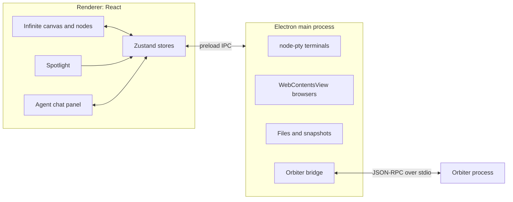

# Flow

Flow is a desktop workspace where terminals, browsers, files, notes, web apps and AI agents sit side by side on one infinite canvas. You pan and zoom instead of switching tabs and windows. Agents can see what is on the canvas and work next to you.

It is an Electron app in React and TypeScript. The repo is named `jatayu-de` after the project's first name, Jatayu DE, a spatial desktop environment.

## What it does

- An infinite canvas with pan, zoom, multi-select, grouping, undo and redo.
- Five kinds of node: a real terminal (xterm.js on node-pty), a live browser (Electron `WebContentsView`), a pinned web app, a file viewer with a fullscreen lightbox, and a note.
- Spotlight, a command palette on `Super+Alt+Space`. Prefixes pick a mode: `@agent` runs an agent, `a:` creates a node, `w:` jumps to a node, `fw:` filters nodes, `fc:` switches canvas, `run:` runs a workflow, `history:` searches history, and `goog`, `yt`, `gh`, `so`, `rdt`, `twt` search the web. `>>` chains steps.
- Agents through Orbiter, the agent framework now published as [Exo](https://github.com/midsphere-ai/exo). Flow starts it as a local process and talks JSON-RPC 2.0 over stdin and stdout. Output streams into a chat panel, tool calls show as cards, and a beam on the canvas shows which node an agent is touching.
- Several canvases, snapshots saved under `~/Flow/canvases`, and restore.
- A file explorer panel, notifications, settings, an onboarding flow, a system tray icon, smart paste and file drop.
- A token counter and a performance indicator.
- A frosted glass design system with a monochrome resting state, focus traps and reduced motion support.

## Numbers

- 68 TypeScript files, about 18,300 lines, plus 430 lines of CSS.
- 39 IPC handlers in the Electron main process for terminals, browser views, files, canvas snapshots and Orbiter.
- The product requirements are in [docs/prd.md](docs/prd.md).
- A 2,096 line design specification in [docs/design-spec.md](docs/design-spec.md).

## How it works



State lives in five Zustand stores: canvas, agents, history, settings and UI. Canvas, history and settings persist between runs. The renderer never touches Node directly. Everything goes through the preload bridge in `electron/preload.ts`.

## Layout

```
electron/
  main.ts          windows, terminals, browser views, files, tray, Orbiter bridge
  preload.ts       the IPC surface exposed to the renderer
src/
  App.tsx
  components/
    canvas/        InfiniteCanvas, AgentBeam
    nodes/         NodeShell, Terminal, Browser, WebApp, File, Note, groups, context menu
    chrome/        top bar, Spotlight, agent chat, settings, file explorer, notifications, onboarding
    chat/          tool call cards
    glass/         GlassPanel, GlassButton, GlassInput, GlassMenu, GlassPill, Tooltip
    layout/        AppShell
  stores/          canvas, agent, history, settings, ui
  hooks/           canvas shortcuts, focus trap
  lib/             canvas save and restore, history actions, canvas context for agents
  styles/          global.css with the design tokens
docs/
  design-spec.md
  prd.md
```

## Run

```sh
npm install
npm run dev
npm run typecheck
npm run build      # packages with electron-builder into release/
```

Agents need an Orbiter command. The default is `python3 -m orbiter`. Change it in Settings.

## Status

Built on 21 and 22 February 2026. The first day was a Tauri and Rust version, the second day this Electron one. Published as it was and not maintained.

## Licence

[MIT](LICENSE). Free to use, change, self-host and build on, including commercially.

Thanks to Electron, React, xterm.js, node-pty, Zustand, Framer Motion, Tailwind CSS and Lucide.
